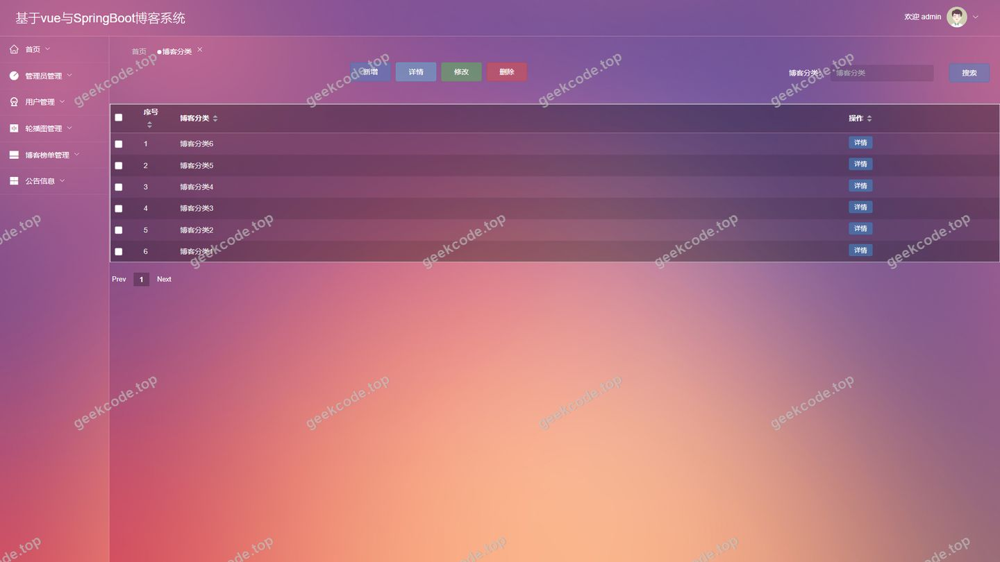
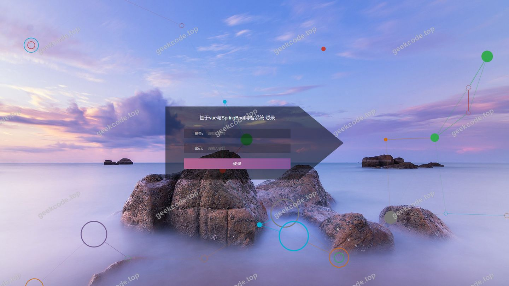
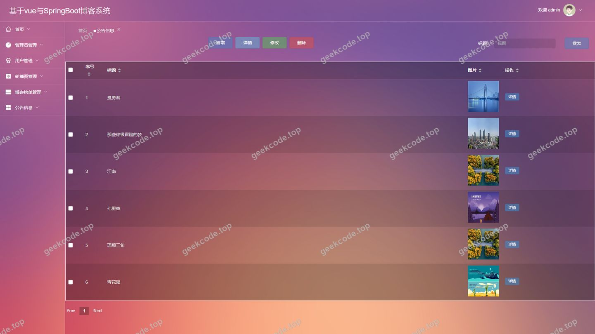
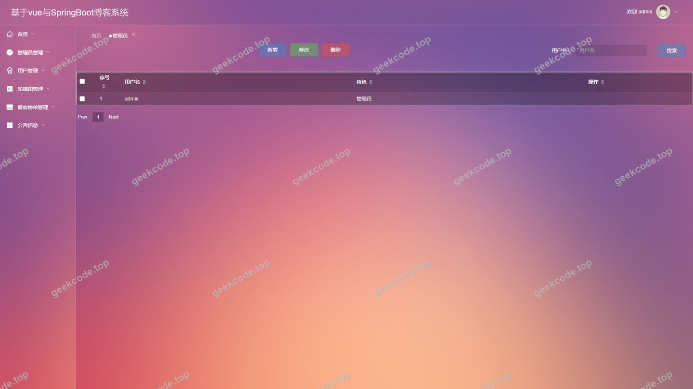
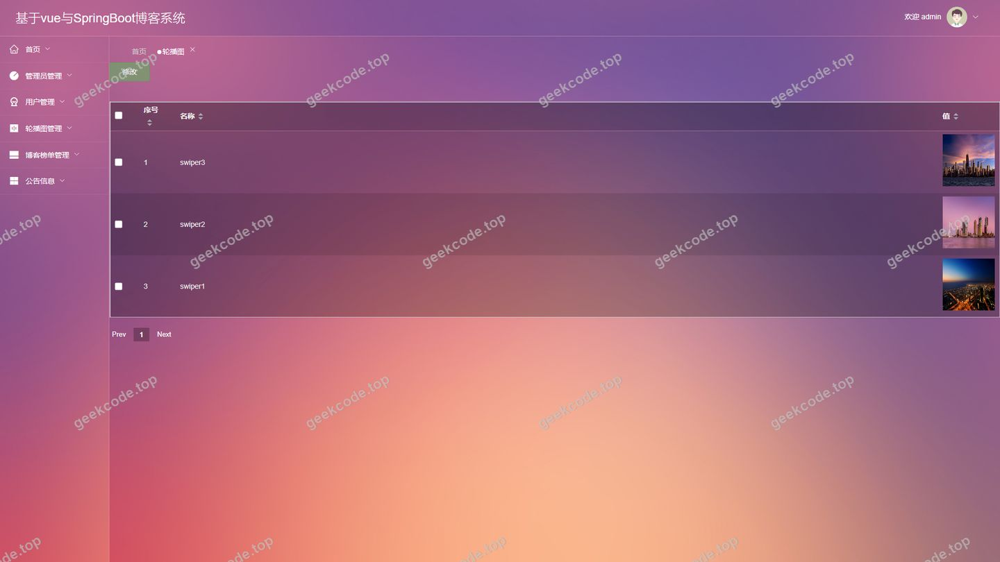
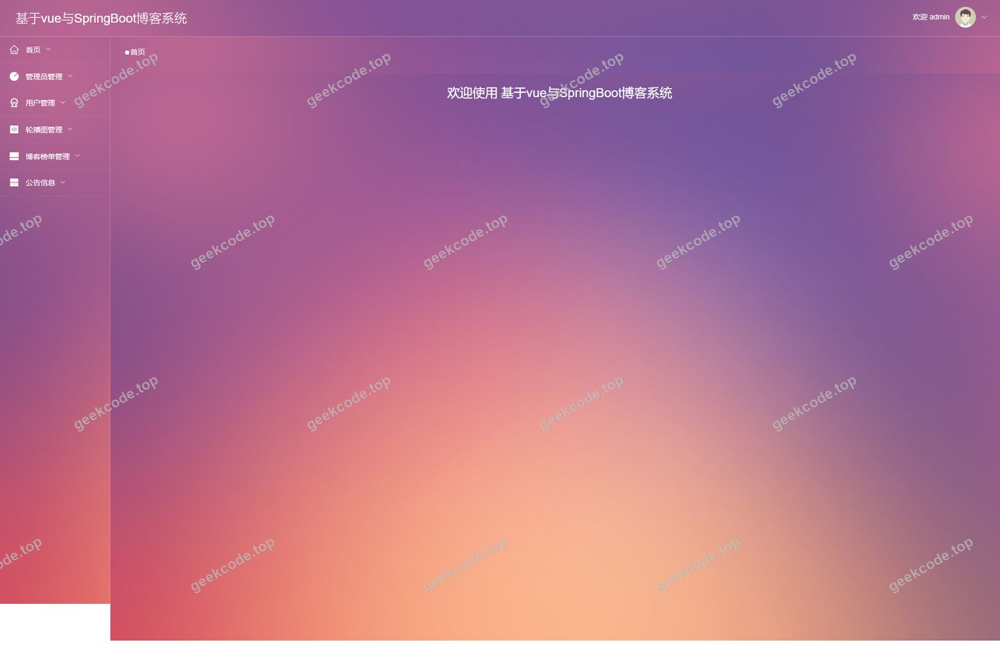
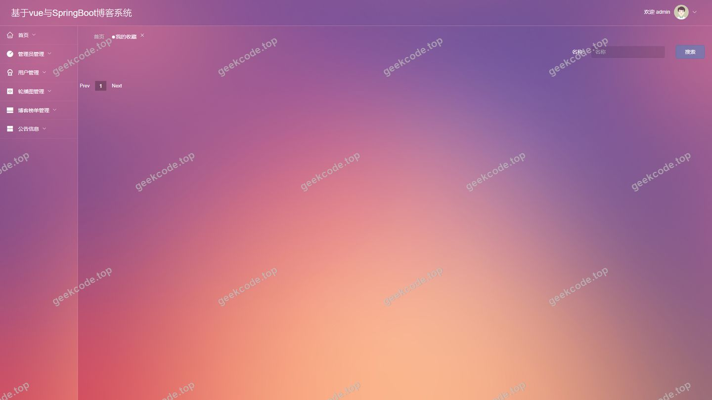
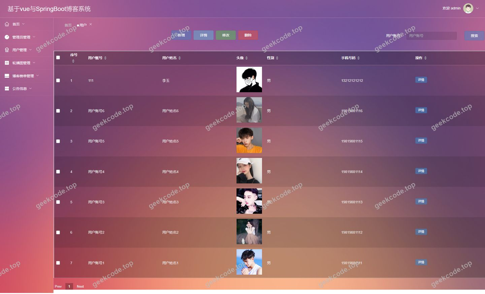

# 基于vue与SpringBoot博客系统

> 🎓 **计算机毕业设计 · 基于vue与SpringBoot博客系统**
>
> 本仓库只放**项目介绍 + 运行截图**（截图是站点带水印的原图，存在仓库 `images/` 里）。
>
> 👉 **完整可运行源码 / 数据库脚本 / 部署文档：[点我获取](https://geekcode.top/archives/%E5%9F%BA%E4%BA%8Evue%E4%B8%8ESpringBoot%E5%8D%9A%E5%AE%A2%E7%B3%BB%E7%BB%9F?utm_source=github)**
>
> 💬 咨询微信：**ir9372**　|　🌐 更多项目：[极客代码 geekcode.top](https://geekcode.top/?utm_source=github)
>
> 📌 项目详情页：<https://geekcode.top/archives/%E5%9F%BA%E4%BA%8Evue%E4%B8%8ESpringBoot%E5%8D%9A%E5%AE%A2%E7%B3%BB%E7%BB%9F?utm_source=github>

<table><td width="230" align="center"> <b>扫码加微信 ir9372</b></td><td valign="middle">📦 源码 = 项目介绍 + 全部运行截图 + 数据库 + 部署文档 👉 点上方任意截图，直接跳到 <b>极客代码 geekcode.top</b> 详情页</td></table>

---

<h1>基于vue与SpringBoot博客系统</h1>
<h2>项目概述</h2>

本项目名为“基于Vue与SpringBoot博客系统”，旨在构建一个前后端分离的博客管理平台，解决传统博客系统在内容管理、用户交互及后台维护方面的效率低下问题。系统核心功能涵盖博客分类管理、博客榜单发布、公告信息管理、用户个人中心以及收藏互动等模块。适用人群包括希望进行个人知识沉淀的博客作者、需要管理社区内容的平台管理员以及浏览阅读的用户群体。技术架构上，后端采用 Spring Boot 框架结合 MyBatis-Plus 实现高效的数据持久层操作，使用 Apache Shiro 保障系统安全性；前端基于 Vue.js 框架构建响应式界面，通过 RESTful API 与后端通信。该项目实现了前台展示与后台管理的完整闭环，具备结构清晰、扩展性强、易于维护的特点，适合用于毕业设计或小型社区系统的原型开发。

<h2>技术架构</h2>

本系统采用典型的前后端分离架构设计，确保了高内聚低耦合的系统特性。

<strong>后端架构：</strong>
基于 Spring Boot 快速搭建应用骨架，利用 <code>spring-boot-starter-web</code> 提供 HTTP 服务接口。数据访问层选用 MyBatis-Plus，通过其强大的 ORM 映射能力和代码生成器简化 CRUD 操作，底层连接 MySQL 数据库（依赖 <code>mysql-connector-java</code>）。安全控制方面集成 Apache Shiro (<code>shiro-spring</code>)，负责身份认证、授权管理及会话控制，确保不同角色访问受保护资源的安全性。参数校验依赖 <code>validation-api</code>，通用工具类使用 <code>commons-lang3</code>。

<strong>前端架构：</strong>
采用 Vue.js 作为核心视图层框架，配合路由机制实现单页面应用（SPA）体验。前端通过 Axios 等网络请求库调用后端提供的 RESTful API 获取数据并渲染页面。根据路由配置，前端分为面向普通用户的浏览注册模块和面向管理员的后台管理模块。

<strong>数据库设计要点：</strong>
数据库主要围绕博客业务实体进行建模，核心表结构推测包含：用户表（存储账号密码及个人信息）、博客分类表（定义文章类别）、博客榜单/文章表（存储具体博客内容及关联分类）、公告信息表（用于系统通知）、收藏记录表（关联用户与博客）以及管理员表（独立于普通用户的管理权限体系）。所有数据交互均通过 ID 关联，保证数据一致性。

<h2>功能模块</h2>

根据源码路由配置及截图功能列表，系统功能划分为前台用户端和后台管理端两大部分。

<h3>前台用户端功能</h3>
<ol>
<li><strong>首页展示 (<code>/index/yonghuList</code>, <code>/index/newsList</code>)</strong></li>
</ol>
<ul>
<li>展示系统最新动态、公告信息及推荐博客列表，作为用户进入系统的第一入口。</li>
</ul>
<ol start="2">
<li><strong>用户中心 (<code>/index/yonghuCenter</code>, <code>/index/yonghuDetail</code>)</strong></li>
</ol>
<ul>
<li>已登录用户可查看个人资料详情，修改个人信息，查看自己的发布记录或收藏状态。</li>
</ul>
<ol start="3">
<li><strong>博客浏览与检索 (<code>/index/bokebangdanList</code>, <code>/index/bokefenleiList</code>)</strong></li>
</ol>
<ul>
<li>用户可按分类浏览博客榜单，查看特定博客的详细文章内容 (<code>/index/bokebangdanDetail</code>)。</li>
</ul>
<ol start="4">
<li><strong>博客发布与管理 (<code>/index/bokebangdanAdd</code>, <code>/index/bokefenleiAdd</code>)</strong></li>
</ol>
<ul>
<li>支持用户新增博客文章，选择所属分类，或对自定义博客分类进行管理。</li>
</ul>
<ol start="5">
<li><strong>收藏功能 (<code>/index/storeupList</code>)</strong></li>
</ol>
<ul>
<li>用户可将感兴趣的博客加入收藏夹，并在列表中统一查看和管理收藏项。</li>
</ul>
<ol start="6">
<li><strong>注册与登录 (<code>/yonghuRegister</code>)</strong></li>
</ol>
<ul>
<li>提供新用户注册入口，完成基础信息录入后成为系统注册用户。</li>
</ul>
<h3>后台管理端功能</h3>
<ol>
<li><strong>系统登录与安全 (<code>/users</code>)</strong></li>
</ol>
<ul>
<li>管理员专属登录界面，验证身份后进入后台控制台。</li>
</ul>
<ol start="2">
<li><strong>博客内容管理 (<code>/bokebangdan</code>)</strong></li>
</ol>
<ul>
<li>对前台展示的博客榜单进行全面管理，包括审核、编辑、删除博客文章。</li>
</ul>
<ol start="3">
<li><strong>分类管理 (<code>/bokefenlei</code>)</strong></li>
</ol>
<ul>
<li>维护博客的分类体系，添加新分类或删除无效分类，规范内容归档。</li>
</ul>
<ol start="4">
<li><strong>用户管理 (<code>/yonghu</code>)</strong></li>
</ol>
<ul>
<li>查看注册用户列表，管理用户状态，必要时进行禁用或重置操作。</li>
</ul>
<ol start="5">
<li><strong>公告信息管理 (<code>/news</code>)</strong></li>
</ol>
<ul>
<li>发布、编辑和删除系统公告，确保重要通知能即时推送到前台首页。</li>
</ul>
<ol start="6">
<li><strong>轮播图配置 (<code>/config</code>)</strong></li>
</ol>
<ul>
<li>管理系统首页或其他页面的轮播图片资源，提升视觉引导效果。</li>
</ul>
<ol start="7">
<li><strong>收藏监控 (<code>/storeup</code>)</strong></li>
</ol>
<ul>
<li>查看全站用户的收藏数据，分析热门内容趋势。</li>
</ul>
<ol start="8">
<li><strong>评论管理 (<code>/discussbokebangdan</code>)</strong></li>
</ol>
<ul>
<li>针对博客下的用户评论进行审核与管理，维护社区讨论氛围。</li>
</ul>
<h2>用户角色与权限</h2>

系统主要存在两类角色：普通用户（前台）和系统管理员（后台）。

<table>
<thead>
<tr>
<th align="left">角色</th>
<th align="left">权限范围</th>
<th align="left">可访问功能模块</th>
</tr>
</thead>
<tbody><tr>
<td align="left"><strong>普通用户</strong></td>
<td align="left">仅限前台操作，需登录后使用部分功能</td>
<td align="left">1. <strong>基础浏览</strong>：查看首页、公告、博客列表及详情。2. <strong>内容创作</strong>：发布博客 (<code>/index/bokebangdanAdd</code>)，创建博客分类 (<code>/index/bokefenleiAdd</code>)。3. <strong>个人管理</strong>：注册 (<code>/yonghuRegister</code>)，查看/修改个人信息 (<code>/index/yonghuCenter</code>, <code>/index/yonghuDetail</code>)。4. <strong>互动功能</strong>：收藏博客 (<code>/index/storeupList</code>)，发表评论。</td>
</tr>
<tr>
<td align="left"><strong>系统管理员</strong></td>
<td align="left">拥有最高权限，仅通过后台入口访问</td>
<td align="left">1. <strong>全局配置</strong>：管理轮播图 (<code>/config</code>)，发布系统公告 (<code>/news</code>)。2. <strong>内容监管</strong>：增删改查博客榜单 (<code>/bokebangdan</code>)，管理博客分类 (<code>/bokefenlei</code>)。3. <strong>用户治理</strong>：查看和管理注册用户 (<code>/yonghu</code>)，处理用户评论 (<code>/discussbokebangdan</code>)。4. <strong>数据监控</strong>：查看全站收藏记录 (<code>/storeup</code>)。</td>
</tr>
</tbody></table>

<em>注：普通用户无法访问任何以 <code>/admin</code> 为前缀的路由或后台管理界面；管理员默认不参与前台博客的公开评论互动，专注于内容审核与系统维护。</em>

<h2>项目特色与创新点</h2>
<ol>
<li>
<strong>前后端完全分离架构</strong>
   摒弃了传统的 JSP/Thymeleaf 模板渲染模式，采用 Vue.js 独立构建前端工程。这种架构使得界面交互更加流畅，用户体验接近原生应用，同时后端专注于业务逻辑与数据处理，提升了系统的可维护性和扩展性。

</li>
<li>
<strong>基于 Shiro 的安全防护体系</strong>
   引入 Apache Shiro 框架替代简单的 Session 判断，提供了细粒度的权限控制能力。不仅实现了基础的登录认证，还能有效防止未授权访问后台敏感接口，保障了用户数据和管理员操作的安全性。

</li>
<li>
<strong>MyBatis-Plus 的高效数据操作</strong>
   利用 MyBatis-Plus 的通用 Mapper 和条件构造器，大幅减少了 XML 配置文件的编写工作量。对于博客系统中常见的分页查询、多条件筛选（如按分类查找博客）等操作，能够以更简洁的代码实现高性能的数据存取。

</li>
<li>
<strong>完整的博客生态闭环</strong>
   从博客分类的定义、文章的发布、到用户的收藏与评论，再到后台的内容审核与公告推送，项目覆盖了博客运营的全生命周期。特别是“博客榜单”与“分类”的双维度管理，既满足了个性化创作需求，又便于平台进行结构化内容分发。

</li>
</ol>
<h2>部署环境</h2>

为确保系统正常运行，需准备以下软硬件环境：

<ol>
<li><strong>开发语言与运行时</strong></li>
</ol>
<ul>
<li><strong>JDK</strong>: Java Development Kit 1.8 或以上版本（建议 JDK 1.8，兼容性好且稳定）。</li>
<li><strong>Node.js</strong>: 用于前端 Vue 项目的依赖安装与编译打包，建议版本 v10+。</li>
</ul>
<ol start="2">
<li><strong>数据库服务</strong></li>
</ol>
<ul>
<li><strong>MySQL</strong>: 版本 5.7 或 8.0。需创建对应的数据库实例，并执行初始化 SQL 脚本以建立表结构（用户表、博客表、分类表等）。</li>
</ul>
<ol start="3">
<li><strong>服务器中间件</strong></li>
</ol>
<ul>
<li><strong>Tomcat</strong>: Spring Boot 内置 Tomcat，无需单独安装外部 Tomcat 容器，直接运行 Jar 包即可启动 Web 服务。</li>
<li><strong>Nginx</strong> (可选): 若生产环境部署，建议使用 Nginx 托管前端静态文件并反向代理后端接口，以实现动静分离。</li>
</ul>
<ol start="4">
<li><strong>构建工具</strong></li>
</ol>
<ul>
<li><strong>Maven</strong>: 用于后端项目的依赖管理和打包构建。</li>
<li><strong>npm / yarn</strong>: 用于前端项目的依赖下载和构建命令执行。</li>
</ul>
<ol start="5">
<li><strong>其他依赖</strong></li>
</ol>
<ul>
<li><strong>浏览器</strong>: Chrome, Firefox, Edge 等现代浏览器，用于访问前端页面。</li>
</ul>
<h2>五、技术特性</h2>
<ul>
<li>前后端分离架构，前端独立部署</li>
<li>使用 MyBatis-Plus 简化数据访问层开发</li>
<li>集成 Shiro 权限框架实现角色权限控制</li>
</ul>
<h2>六、功能模块截图</h2>
<h3>后台管理端</h3>
<h4>后台-博客分类</h4>

<h4>后台-登录页</h4>

<h4>后台-公告信息</h4>

<h4>后台-管理员</h4>

<h4>后台-轮播图</h4>

<h4>页面-首页</h4>

<h4>后台首页</h4>

<h4>后台-我的收藏</h4>

<h4>后台-用户</h4>

---

## 获取完整源码

| 项目 | 说明 |
| --- | --- |
| 项目名 | 基于vue与SpringBoot博客系统 |
| 运行截图 | 本文 9 张（站点带水印原图，仓库 `images/` 目录） |
| 完整源码 | [https://geekcode.top/archives/%E5%9F%BA%E4%BA%8Evue%E4%B8%8ESpringBoot%E5%8D%9A%E5%AE%A2%E7%B3%BB%E7%BB%9F?utm_source=github](https://geekcode.top/archives/%E5%9F%BA%E4%BA%8Evue%E4%B8%8ESpringBoot%E5%8D%9A%E5%AE%A2%E7%B3%BB%E7%BB%9F?utm_source=github) |
| 咨询微信 | **ir9372**（备注：jingpin-yuanma） |
| 更多项目 | [极客代码 geekcode.top](https://geekcode.top/?utm_source=github) |

> 需要源码、部署、改配置、跑不起来等问题，加微信 ir9372 沟通，说明项目名即可。
